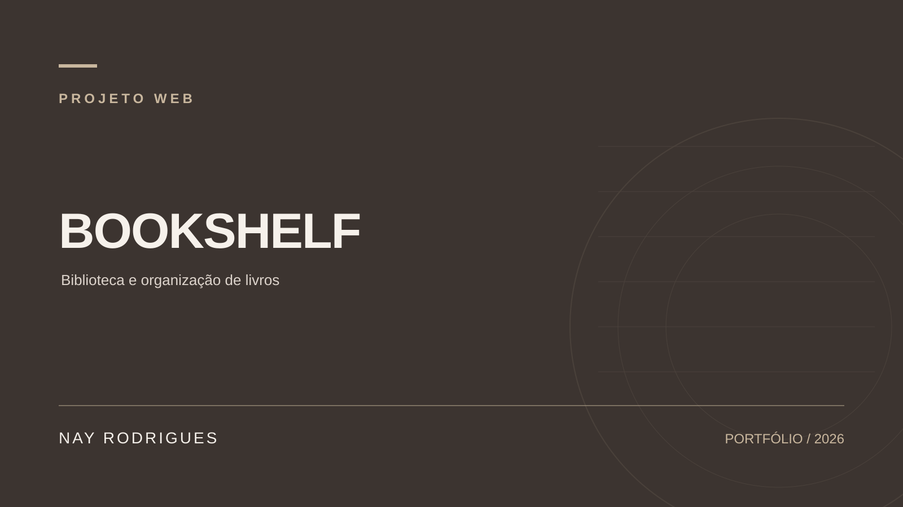

<div align="center">



# BookShelf

Projeto de organização e apresentação de livros em uma aplicação web

**Projeto web**

</div>


Projeto inicial com:

- Next.js 15
- React 19
- TypeScript
- TailwindCSS v4
- shadcn/ui

## Rodar localmente

```bash
npm install
npm run dev